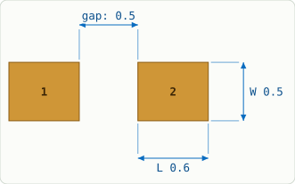
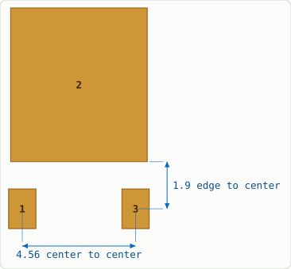
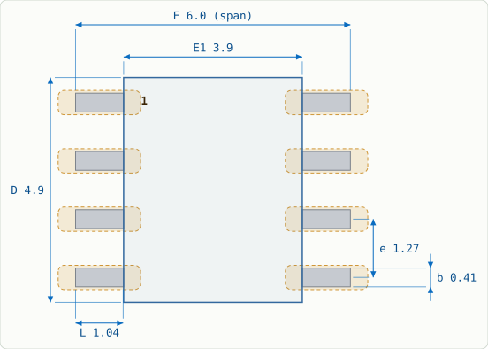
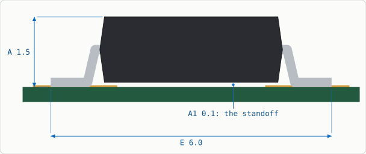

# Tutorial

This tutorial builds footprints from the simplest two-pad part up to a whole library
with 3D models. Each step has an example. In the stomp editor, **Try it** turns it
into an editor right on the page, with the footprint drawn beside it: change the code
and the drawing follows, and the cursor on a line shows what it places. On GitHub,
copy the code into the editor instead.

You don't need to know anything about stomp to start. Knowing what a land pattern is
helps: the copper pads a part is soldered to, with the silkscreen, paste and
courtyard that go with them.

## 1. A first footprint

A footprint is a block: a header line, its statements, then `end`. This one is an 0402
resistor, typed in from a recommended land pattern:

```stomp
footprint "R0402"
  pins 2 horizontal            # two pads in a row, pin 1 on the left
  default pad rect 0.5 x 0.6   # each pad 0.5 across, 0.6 long
  gap: 0.5                     # 0.5 between the pads' facing edges
end
```

Three things to notice:

- `#` starts a comment.
- A value with a name takes a colon: `gap: 0.5`. Words that relate things, like the
  `x` in `0.5 x 0.6`, don't.
- Numbers are millimeters unless you say otherwise.



*`gap: 0.5` is the space between the pads' facing edges. Generated pads turn to face
outward, so in `rect 0.5 x 0.6` the 0.5 runs across the part (W) and the 0.6 along it
(L).*

Try changing the gap to `0.8`. The pads move apart as you type, and anything wrong is
underlined and listed under **Problems**.

## 2. Measure the way the drawing does

Datasheet drawings rarely give coordinates. They measure from one feature to another:
pin to pin, edge to edge, edge to center. stomp lets you type those measurements as
drawn. This is a DPAK (TO-252):

```stomp
footprint "TO-252"
  pad 1 rect 1.1 x 1.6
  pad 3 rect 1.1 x 1.6
  pad 2 rect 5.5 x 6.2                       # the tab

  pad 3 is 4.56 right of pad 1               # center to center
  pad 2 is centered between pad 1 and pad 3 horizontally
  pad 2 inner is 1.9 above pad 1             # the tab's near edge, from the pin centers
end
```

A placement says how far one object is from another, in which direction. It measures
center to center unless you name an edge: `inner` is the edge facing the other object,
`outer` the edge facing away. So `pad 2 inner is 1.9 above pad 1` measures from the
tab's bottom edge to the center of pad 1, exactly as the drawing does.



*`pad 3 is 4.56 right of pad 1` measures center to center. `pad 2 inner is 1.9 above
pad 1` measures from the tab's inner edge, the one facing the pins, to their centers.*

Put the cursor on a placement line: the drawing shows that dimension. Each object needs
exactly one placement per axis, and stomp tells you, naming both lines, if one is
placed twice or not at all.

## 3. Describe the part instead

For a standard package you don't need to place pads at all. Describe the part, its
body, pins and leads, and stomp works out the land pattern the way IPC-7351 does:

```stomp
footprint "SOIC-8"
  body 3.9 x 4.9 x 1.5                 # width x length x height
  pins 8 dual pitch: 1.27              # two rows, pin 1 at the top left
  lead gullwing 0.41 x 1.04 span: 6.0  # lead width x foot length; span is tip to tip
  pin1: dot
end
```



*The drawing's letters: `body 3.9 x 4.9` is E1 x D, `pitch: 1.27` is e, and
`lead gullwing 0.41 x 1.04 span: 6.0` is b x L, with the span E from tip to tip. The
dashed outlines are the lands stomp works out from them.*

The numbers are the ones in the package drawing. The pads, the silkscreen outline kept
clear of the copper, the pin-1 dot and the courtyard all follow from them. The details
panel under the drawing lists every pad's size and position.

Other arrangements work the same way: `pins 32 quad pitch: 0.5` for four sides,
`pins 2 horizontal` for a chip, `pins grid 5 x 2 pitch: 2.54` for a header. The lead
forms include `gullwing`, `jlead`, `flat` (QFN and DFN), `endcap` (chip passives),
`ball` (BGA) and `pin` and `wire` for through-hole parts.

## 4. Change what was generated

Generated pads are ordinary pads, so any statement about one overrides what was
generated. Here the SOIC gets longer pads for hand soldering and an exposed pad with
its paste split into windows and thermal vias:

```stomp
footprint "SOIC-8-EP-HS"
  body 3.9 x 4.9 x 1.5
  pins 8 dual pitch: 1.27
  lead gullwing 0.41 x 1.04 span: 6.0
  default pad rect 0.6 x 2.2           # 0.6 wide, 2.2 long
  thermal pad 9 2.4 x 3.1 paste: divide 2 x 2 coverage: 60%
  pad 9 vias: 2 x 3 drill: 0.3 pitch: 1.0
  pin1: dot
end
```

`thermal pad` adds a pad centered on the body. `pad 9 vias: …` changes one property of
pad 9 and keeps the rest. `pads 1..4 mask: +0.1` would change several at once, and
`delete pad 3` removes one.

## 5. Pin 1, polarity and the silkscreen

The silkscreen and the courtyard are automatic. You choose the pin-1 mark, and mark a
polarized part:

```stomp
footprint "D-SMA"
  description: "Diode, SMA (DO-214AC)"
  refdes: "D"
  body 4.3 x 2.6 x 2.1
  pins 2 horizontal
  lead lbend 1.4 x 1.0
  polarized                            # pin 1 is the anode; the bar marks the cathode
  text "K" at (3.3, 0) size: 0.8       # your own silk text, by the cathode
  courtyard: auto 0.5                  # more room around the part
end
```

`pin1:` takes `dot`, `chamfer`, `notch`, `bar` or `none`. `polarized` puts a bar by
the cathode and a stripe on the 3D body. Lines, arcs, circles and text you write go on
the silkscreen, or on the assembly drawing with `layer: assembly`.

## 6. Through-hole parts

A through-hole pad says `tht` and has a drill. `default pad` gives every pad the same
one, and a pad of its own overrides it, here the square pin 1:

```stomp
footprint "HDR-1x4-2.54"
  refdes: "J"
  body 10.16 x 2.54 x 8.5
  pins grid 4 x 1 pitch: 2.54
  lead pin 0.64 x 0.64                 # square pins
  default pad tht circle 1.7 drill: 1.0
  pad 1 tht rect 1.7 x 1.7 drill: 1.0
  origin at pad 1                      # place the part by pin 1
end
```

`origin at pad 1` moves the footprint's (0, 0), which is the body's center unless you
say otherwise.

## 7. Names, units and arithmetic

Give the datasheet's letter dimensions names and use them, with arithmetic where the
drawing needs it. `units: mil` switches a file, a footprint or a template to mils, and
any number can carry its own unit (`0.3mm`, `12mil`):

```stomp
E1 = 4.4          # body width
D = 5.0           # body length
e = 0.65          # pitch
E = 6.4           # lead span

footprint "TSSOP-14"
  body E1 x D x 1.2
  pins 14 dual pitch: e
  lead gullwing 0.25 x 0.6 span: E
  default pad rect 0.45 x (E - E1) / 2 + 0.4
  pin1: dot
end
```

A name can be any word but `x` and `end`. Text in quotes can include values: `"{e}"`
prints the pitch.

## 8. A family from one template

A template is a footprint with parameters. It can name the footprints it makes, and a
table calls it once per row. This is how stomp writes whole libraries:

```stomp
template soic(n, D, lspan = 6.0)
  name: "SOIC-{n}_3.9x{D}mm_P1.27mm"
  description: "SOIC, {n} pins, 3.9 x {D} mm body"
  refdes: "U"
  body 3.9 x D x 1.5
  pins n dual pitch: 1.27
  lead gullwing 0.41 x 1.04 span: lspan
  pin1: dot
end

footprints from soic
  n    D
  8    4.9
  14   8.65
  16   9.9
end
```

The header row names the parameters each column fills. **Library** above the drawing
shows every footprint in the file. One footprint can call a template too, with
arguments by position or by name: `footprint "MY-SOIC-8" from soic(8, 4.9, lspan: 6.2)`.
And `extends` makes a variant of another footprint.

## 9. The 3D model

**3D** above the drawing shows the part on a board. The model comes from what you've
already written: the body's height, the pins and the lead form.



*From the front: the body's height, 1.5 in `body 3.9 x 4.9 x 1.5`, is the seated height
A, from the board to the top of the part. The body sits on its standoff A1, which the
lead form sets: 0.1 for gull-wings.*

A `model` block adjusts the model:

```stomp
footprint "CP-RADIAL-6.3x11"
  description: "Radial electrolytic, 6.3 mm can, 2.5 mm lead spacing"
  refdes: "C"
  body cylinder d: 6.3 h: 11
  pins 2 horizontal pitch: 2.5
  lead wire d: 0.5
  default pad tht circle 1.4 drill: 0.8
  polarized                            # the stripe goes by the negative lead
  model
    body color: "#2b5a3a"              # a green sleeve
    leads color: tin
  end
end
```

The block can also change the standoff (`standoff: 0.1`), the leads' thickness, the
draft of a molded body, and add solids of your own, like `box 2 x 1 x 0.2 on body`.
The view's buttons export the model as VRML for KiCad or as STL.

## 10. Features of your own

A feature is a named drawing you can use anywhere in the file: a mark, a logo, a 3D
part. It takes parameters like a template:

```stomp
feature arrowhead(s = 0.6)
  polygon (0, 0) (-s, s / 2) (-s, -s / 2) fill
end

footprint "SOT-23"
  body 1.3 x 2.9 x 1.0
  pins
    left: 1, 2 pitch: 1.9
    right: 3
  end
  lead gullwing 0.4 x 0.5 span: 2.4
  pin1: arrowhead                      # the pin-1 mark, where the dot would go
  feature arrowhead(0.8) at (2.4, 0) rotate: 180   # and one pointing at pin 3
end
```

A feature can hold solids too, and choose between versions of itself with
**sections** that a flag in the call turns on:

```stomp
feature fin_stack(W, L, h)
  box W x L x 0.3 color: aluminum
  box W x 0.4 x h at (0, -L / 3, 0) color: aluminum
  box W x 0.4 x h at (0, L / 3, 0) color: aluminum
  section tall
    box W x 0.4 x 2 * h at (0, 0, 0) color: aluminum
  end
end

footprint "QFN-16-HS"
  body 3 x 3 x 0.9
  pins 16 quad pitch: 0.5
  lead flat 0.25 x 0.4
  thermal pad 1.7 x 1.7
  feature fin_stack(2.6, 2.6, 1.5, tall) on body
end
```

`on body` rests the feature's solids on top of the body. There's no `if` in stomp:
sections are how a feature makes choices.

## 11. The standard library

Every body, lead and mark stomp draws comes from its standard library, written in
stomp. Its packages name a body the lead form can't describe, its symbols mark the
silk, and the part's refdes adds details on its own, like an LED's dome for `D`:

```stomp
footprint "TO-220-3_Vertical"
  refdes: "U"
  body 10.2 x 4.5 x 15.6
  pins grid 3 x 1 pitch: 2.54
  lead wire 0.8 x 0.5
  default pad tht oval 1.8 x 2.4 drill: 1.2
  pin1: triangle(a: -90)               # a symbol from the library
  model
    body shape: to220                  # a package from the library
  end
end
```

A feature of yours with a library feature's name replaces it in your file, so
`feature can_vent(D)` redraws the vent of every can. The
[standard library page](../stdlib/README.md) lists everything in it, and the library's
files open in the editor's file picker, at the bottom.

## 12. Save your work and export it

Examples are yours to change: your edits are kept until you press **Reset**. To keep a
file of your own, use the **File** menu:

- **New file** or **Save as** keeps a file in this browser, saved as you type.
- **Save to disk** writes a `.stomp` file to your computer, and **Open from disk**
  (or dropping files on the page) brings `.stomp` files back.
- **Export to KiCad** saves every footprint in the file as a KiCad library, with
  its 3D models inside.

[Using stomp](using.md) covers the editor in more detail, and the
[language reference](reference.md) has every statement.
